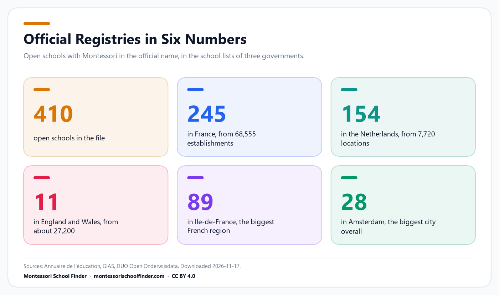
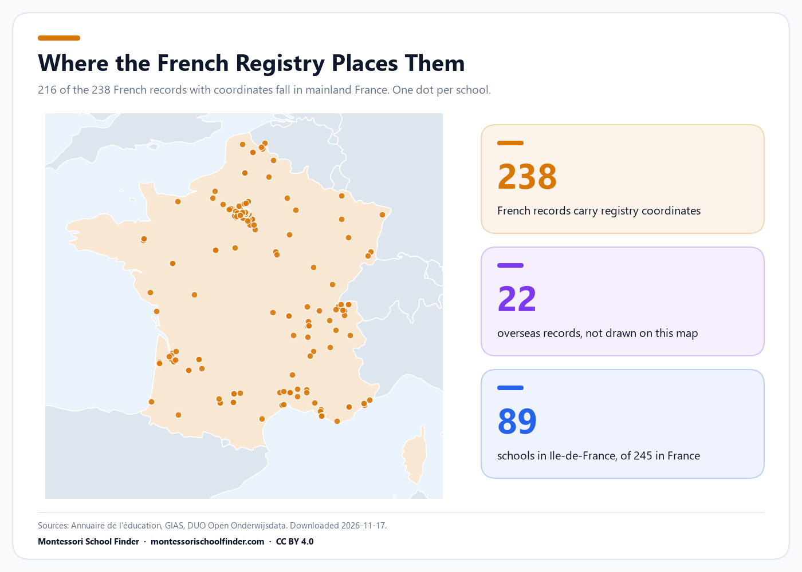
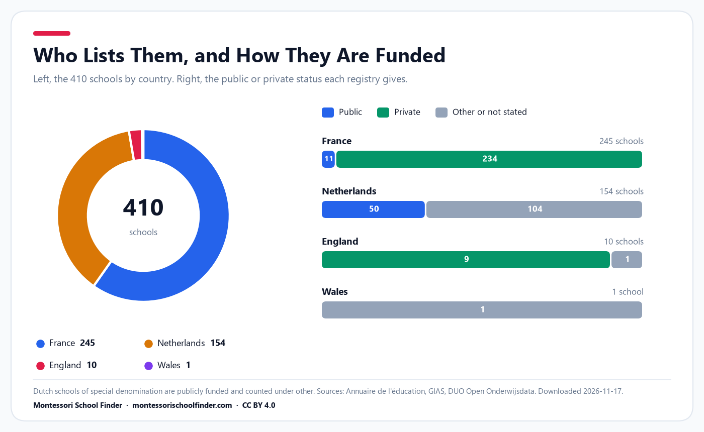
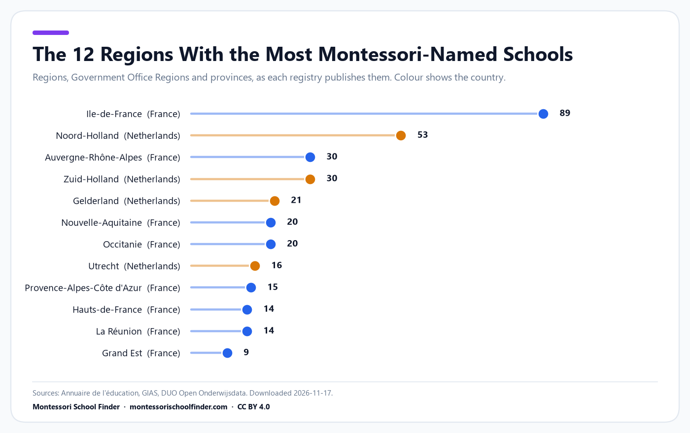

# Montessori Schools in Official School Registries

[](https://creativecommons.org/licenses/by/4.0/) [](https://www.kaggle.com/datasets/mariamontessori/montessori-schools-official-registries) [](https://huggingface.co/datasets/montessoritheory/montessori-schools-official-registries)


**An open dataset from [Montessori School Finder](https://www.montessorischoolfinder.com/), the worldwide Montessori school directory.**

English first, version française plus bas, resumen en español al final.

## Montessori Schools Listed By Governments, Not By Us

Anyone can call a school Montessori. So what happens when you ask the official school lists of three countries which schools carry the name? This dataset is the answer. It takes the national school registries of **France**, **England and Wales** and **the Netherlands**, keeps every **open school whose official name contains "Montessori"**, and puts them in one clean table with the official identifier, address, status and, for France, coordinates.

You get **410 open schools**. France has 245, the Netherlands has 154, England has 10 and Wales has 1. Every record can be checked at its source, and nothing comes from Google or from any private listing.

Use it to count and map Montessori schools, to study how the word is used in school names, to add a clean, official identifier to your own school data, or as a starting list for research. To find a school near you, browse the [Montessori School Finder locations](https://www.montessorischoolfinder.com/locations/).

### The Headline Numbers

|  |  |
|---|---|
| Open schools with Montessori in the official name | 410 |
| France (Annuaire de l'éducation) | 245 of 68,555 establishments, 0.36 % |
| The Netherlands (DUO) | 154 of 7,720 school locations, 2.0 % (131 primary, 23 secondary) |
| England (GIAS) | 10 of about 27,200 open establishments, 0.04 % |
| Wales (GIAS) | 1 |
| France, private / public | 234 private (227 without a state contract), 11 public |
| France, level | 197 schools, 40 collèges, 8 lycées |
| Biggest region in France | Île-de-France 89, then Auvergne-Rhône-Alpes 30 and Nouvelle-Aquitaine 20 |
| Biggest city overall | Amsterdam 28 schools, then 's-Gravenhage (The Hague) 10 |
| Paris, all arrondissements | 34 schools |
| Records with a Montessori School Finder city page | 320 of 410 |









### Files

| file | content |
|---|---|
| `data/montessori_schools_official_registries.csv` | 410 rows, one per open school, all three registries |
| `data/by_country.csv` | 4 rows, schools, cities, public and private, per country |
| `data/by_region.csv` | 32 rows, regions and provinces ranked inside each country |
| `data/by_type.csv` | 10 rows, type or phase against public or private status |
| `data/by_city.csv` | 276 rows, cities with at least one school |
| `data/registry_totals.csv` | all open establishments in each registry file, the denominator for shares |
| `data/montessori_schools_with_coordinates.geojson` | the 238 French records that carry registry coordinates |
| `data_dictionary.csv` | every column of every file |
| `scripts/` | the code that downloads the registry files and rebuilds everything |
| `notebooks/starter.ipynb` | a starter notebook, already run |

### Columns

**montessori_schools_official_registries.csv**

| column | description |
|---|---|
| `country`, `country_code` | France (FR), England (GB-ENG), Wales (GB-WLS) or Netherlands (NL) |
| `registry` | The official registry the record comes from |
| `official_id` | The registry identifier. UAI in France, URN in England and Wales, vestigingscode in the Netherlands |
| `name` | The school name as the registry publishes it |
| `type_phase` | Type of establishment. For the Netherlands, primary or secondary |
| `registry_category` | A second category from the registry, such as the denomination in the Netherlands |
| `public_or_private` | Public or private status as the registry gives it, see Read With Care |
| `status` | Registry status. Always Open in this release |
| `address`, `postcode`, `city`, `region` | Location as published. Region is a region, a Government Office Region or a province |
| `latitude`, `longitude` | Coordinates, only where the registry publishes them (France) |
| `age_range_or_phase` | Statutory age range (England, Wales) or maternelle and elementaire flags (France) |
| `source_url` | Link to the registry record or file |
| `retrieved_at` | Date the registry files were downloaded |
| `match_reason` | Why the school is in the dataset. Always "name contains Montessori" |
| `msf_city_url` | Optional link to the matching Montessori School Finder city page |

The other files are described column by column in `data_dictionary.csv`.

### Load It

```python
import pandas as pd

base = "https://raw.githubusercontent.com/montessoritheory/montessori-schools-official-registries/main/data"
schools = pd.read_csv(f"{base}/montessori_schools_official_registries.csv", dtype=str)
schools.groupby(["country", "region"]).size().sort_values(ascending=False).head(10)

pd.read_csv(f"{base}/by_country.csv")
```

### How It Was Built

The three registry files were downloaded on 17 November 2026 and read as plain data.

- **France.** The full export of the open dataset [Annuaire de l'éducation](https://data.education.gouv.fr/explore/dataset/fr-en-annuaire-education/) (68,555 establishments, all marked open), from data.education.gouv.fr.
- **England and Wales.** The `edubasealldata` file of [Get Information About Schools](https://get-information-schools.service.gov.uk/), the Department for Education register, dated 17 November 2026.
- **The Netherlands.** The two DUO files of school locations, [primary](https://duo.nl/open_onderwijsdata/images/02.-alle-schoolvestigingen-basisonderwijs.csv) and [secondary](https://duo.nl/open_onderwijsdata/images/02.-alle-vestigingen-vo.csv), from [DUO Open Onderwijsdata](https://duo.nl/open_onderwijsdata/).

A school is kept when its **name contains "Montessori"**, ignoring case and accents, and when the registry marks it as open. The Dutch files have no teaching method field, only denomination, and the French and English files have none either, so the name is the only signal. Nothing was estimated, geocoded or filled in. `scripts/download.py` fetches the files, `scripts/build_dataset.py` builds the main table and `scripts/make_outputs.py` builds the summaries, the GeoJSON and the charts. The optional `msf_city_url` column is filled only when the build script gets the path of a Montessori School Finder database. Without it the column stays empty.

### Checked Against The Source

- Ten records per country were drawn at random and compared with the registry file. Name and postcode matched in all 30 cases.
- Ten French records were also compared with the live registry API on the day of download. All ten matched and were still open.
- Every summary table adds up to the 410 rows of the main file.
- No identifier appears twice in a country.

### Read With Care

- **The name is the only test.** A school that teaches the Montessori method without the word in its name is missing. A school with the word in its name may not follow the method, and no registry checks that. The word is not protected in these countries.
- **England is a small count for a reason.** GIAS lists schools and a few other settings. Most Montessori early years settings in England are nurseries registered elsewhere, so they are not in this file. The same limit can apply in France and the Netherlands, where the registries list schools, not every childcare or nursery group.
- **The Dutch files list locations.** One school board can run several locations, and a campus with a primary and a secondary part appears twice, once in each file. Counts are locations, not school boards.
- **Public and private are not the same word everywhere.** France gives a public or private status. GIAS gives a type, and independent schools are marked private here. In the Netherlands, schools of special denomination are publicly funded, so they are shown as publicly funded, special or denominational, not as private.
- **Coordinates only for France.** The English and Dutch files carry no latitude and longitude in the files used. England has British National Grid coordinates in GIAS, which were not converted.
- **Overseas France is included.** Schools in La Réunion and other overseas regions are part of the French registry and are in the table (21 schools).
- **Closed schools are left out.** GIAS holds 65 closed schools with Montessori in the name. They are not in this release. Two GIAS records in Morocco were also left out.
- **Place names are as published.** French Paris records keep the arrondissement. Dutch place names were put into normal case and DUO's municipality suffix was removed. One English record has no town in GIAS. A few Dutch place names keep the province tag DUO uses to tell towns apart, for example "Hoorn Nh".
- **Snapshot.** Registries change every week. This is the state on 17 November 2026.

### Image Credits

Country outlines in the France map from [Natural Earth](https://www.naturalearthdata.com/), public domain. Charts by Montessori School Finder.

### License And Citation

**[CC BY 4.0](https://creativecommons.org/licenses/by/4.0/)** for the compilation. Use it, share it and adapt it, commercially or not, and credit **Montessori School Finder** with a link to **[montessorischoolfinder.com](https://www.montessorischoolfinder.com/)**.

The underlying records keep the licence of their registry, and you must keep these statements with any reuse.

- **France.** Source: Ministère de l'Éducation nationale, *Annuaire de l'éducation*, data.education.gouv.fr, updated 17 November 2026. Licence Ouverte / Open Licence 2.0 (Etalab).
- **England and Wales.** Source: Department for Education, *Get Information About Schools*. Contains public sector information licensed under the [Open Government Licence v3.0](https://www.nationalarchives.gov.uk/doc/open-government-licence/version/3/).
- **The Netherlands.** Source: DUO, *Open Onderwijsdata*. Released under CC0 1.0. Credit is given as a courtesy.

This dataset is not an official product of these bodies and they do not endorse it. School contact details, such as telephone numbers, emails and head teachers, are not included.

```bibtex
@misc{montessorischoolfinder_montessori_schools_official_registries_2026,
  title  = {Montessori Schools in Official School Registries},
  author = {{Montessori School Finder}},
  year   = {2026},
  url    = {https://github.com/montessoritheory/montessori-schools-official-registries},
  note   = {Dataset, version 1.0, built from the Annuaire de l'education, GIAS and DUO Open Onderwijsdata}
}
```

Also on **[Kaggle](https://www.kaggle.com/datasets/mariamontessori/montessori-schools-official-registries)**, with a starter notebook, and on **[Hugging Face](https://huggingface.co/datasets/montessoritheory/montessori-schools-official-registries)**, ready for the `datasets` library.

---

## Version Française

### Les écoles Montessori dans les registres officiels

Ce jeu de données reprend les écoles **ouvertes dont le nom officiel contient "Montessori"** dans les registres publics de **France** (Annuaire de l'éducation, Licence Ouverte 2.0), d'**Angleterre et du pays de Galles** (GIAS, Open Government Licence v3.0) et des **Pays-Bas** (DUO, CC0). Il compte **410 écoles**, dont **245 en France**, 154 aux Pays-Bas, 10 en Angleterre et 1 au pays de Galles. Chaque ligne a l'identifiant officiel (UAI, URN ou code DUO), l'adresse, le statut et, pour la France, les coordonnées, avec des tableaux par pays, région, type et ville.

À savoir. Le nom est le seul critère, car aucun registre ne vérifie la pédagogie. Une école qui applique la méthode sans le mot dans son nom n'apparaît pas. Les écoles fermées sont exclues. Données du 17 novembre 2026. Licence CC BY 4.0 pour la compilation, en citant Montessori School Finder avec un lien vers montessorischoolfinder.com, et avec les mentions des licences d'origine (voir plus haut). Pour trouver une école près de chez vous, voir [Montessori School Finder](https://www.montessorischoolfinder.com/).

## Versión En Español

### Escuelas Montessori en los registros oficiales

Este conjunto de datos reúne las escuelas **abiertas cuyo nombre oficial contiene "Montessori"** en los registros públicos de **Francia** (Annuaire de l'éducation), **Inglaterra y Gales** (GIAS) y **los Países Bajos** (DUO). Son **410 escuelas**, **245 en Francia**, 154 en los Países Bajos, 10 en Inglaterra y 1 en Gales. Cada fila trae el identificador oficial, la dirección, el estado y, para Francia, las coordenadas, con tablas por país, región, tipo y ciudad.

Hay que tener en cuenta que el nombre es el único criterio, porque ningún registro comprueba la pedagogía. Las escuelas cerradas no se incluyen. Datos del 17 de noviembre de 2026. Licencia CC BY 4.0 para la compilación, con crédito a Montessori School Finder y enlace a montessorischoolfinder.com, y con las menciones de las licencias de origen. Para encontrar una escuela cerca de usted, vea [Montessori School Finder](https://www.montessorischoolfinder.com/).

---

**Part of the [Montessori School Finder open datasets](https://github.com/montessoritheory/montessori-schools-open-data).** Directory at [montessorischoolfinder.com](https://www.montessorischoolfinder.com/).
